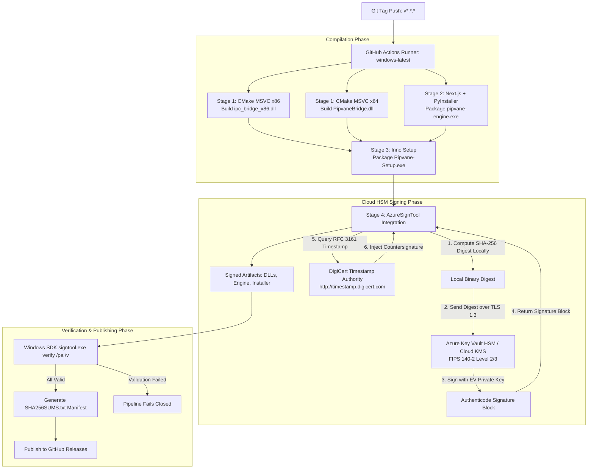

# Pipvane v3: Sprint 25 Architecture Blueprint
## Cloud HSM EV Code Signing & Release Automation Specification

* **Document Version:** 3.0.0-PROD-SPEC
* **Status:** PROPOSED / PENDING TECHNICAL SIGN-OFF (Strict Mode Enforced)
* **Author:** Pipvane v3 Tech Lead & System Architect
* **Date:** November 2026
* **Target Milestone:** Sprint 25 Implementation Gate
* **Canonical CI Workflow:** [.github/workflows/release.yml](file:///f:/Personal%20Project/Signal%20Copier/Pipvane/.github/workflows/release.yml)

---

## 1. Executive Summary & Security Mandates

This specification defines the cryptographic release pipeline for signing all Pipvane v3 Windows binaries, including the desktop installer, core engine executable, and native C++ MetaTrader DLL bridges.

### 1.1 CA/Browser Forum HSM Hardware Mandate
Effective June 1, 2023, the CA/Browser Forum Baseline Requirements mandate that private keys for **all** code signing certificates (Standard and Extended Validation) must be generated and stored on cryptographic hardware modules certified to at least **FIPS 140-2 Level 2** or **Common Criteria EAL 4+**. Traditional software-exported `.pfx` files stored in repository secrets are strictly prohibited and rejected by modern certificate authorities.

### 1.2 Zero Private Key Exposure Invariant
The Pipvane CI/CD pipeline enforces the following immutable security guarantees:
* **No Private Key In Transit or At Rest on Runners:** The private key never leaves the physical boundary of the Cloud Hardware Security Module (Azure Key Vault HSM or AWS KMS).
* **Digest-Only Remote Signing:** During code signing, the runner hashes the compiled binary locally (`SHA-256`), sends strictly the digest over TLS 1.3 to the Cloud HSM, receives the digital signature block, and embeds it into the PE Authenticode structure.
* **Dual Verification Gate:** Every binary must pass mathematical verification via Microsoft Windows SDK `signtool.exe verify /pa /v` before it can be published to the GitHub Release.

---

## 2. Architecture Decision Record (ADR-004)

### ADR-004: Cloud HSM Code Signing via Azure Key Vault and AzureSignTool

* **Status:** ACCEPTED / PENDING TECHNICAL SIGN-OFF
* **Date:** 2026-11-22
* **Deciders:** Pipvane Tech Lead & System Architect, QA Automation Engineer, DevOps Lead

#### 2.1 Context
Pipvane v3 distributes native Windows desktop software:
1. `Pipvane-Setup.exe`: Per-user Windows installer.
2. `pipvane-engine.exe`: Core desktop execution agent.
3. `ipc_bridge_x86.dll`: 32-bit native C++ DLL bridge for MetaTrader 4.
4. `PipvaneBridge.dll`: 64-bit native C++ DLL bridge for MetaTrader 5.

Unsigned or self-signed software triggers aggressive Microsoft Defender SmartScreen warnings ("Windows protected your PC - Unknown Publisher"), causing user drop-off and antivirus false positives. Furthermore, MetaTrader 5 terminals running in high-security broker environments reject unsigned external DLLs.

#### 2.2 Decision
We adopt **Cloud HSM Code Signing via Azure Key Vault using `AzureSignTool`**, paired with Microsoft Windows SDK `signtool.exe` for local verification:
1. **Key Storage:** The Extended Validation (EV) Code Signing Certificate is provisioned directly in an Azure Key Vault Premium HSM (FIPS 140-2 Level 3 certified) or DigiCert ONE / Azure Trusted Signing.
2. **Signing Engine:** The pipeline utilizes `AzureSignTool`, a battle-tested .NET tool recommended by Microsoft and DigiCert. It authenticates to Azure via Service Principal credentials (or OIDC Federated Workload Identity), transmits the binary hash, and receives the signed Authenticode block.
3. **Timestamping:** All signatures are stamped using an RFC 3161 compliant timestamp server (`http://timestamp.digicert.com`) using SHA-256 (`-td sha256`). This ensures the signatures remain valid indefinitely, even after the certificate itself reaches its expiration date.
4. **Verification Step:** After signing, `signtool.exe verify /pa /v` is executed against all artifacts. If any signature or timestamp is invalid, the entire pipeline fails closed.

#### 2.3 Consequences
* **Positive:**
  * Zero risk of private key leakage or theft from CI runners.
  * Instant Microsoft SmartScreen reputation across all distributed Windows executables.
  * Complies with all enterprise and regulatory standards for commercial financial software.
  * Fully automated release flow triggered by git version tags (`v*.*.*`).
* **Negative:**
  * Requires cloud infrastructure setup (Azure Key Vault or AWS KMS) and associated API operation costs.
  * In local/offline development environments, builds run in unsigned or test-certificate simulation mode.

---

## 3. End-to-End Release Pipeline Architecture



---

## 4. Targeted Binaries & Signing Matrix

Every released artifact is signed using SHA-256 with an RFC 3161 timestamp:

| Target Binary | Architecture | Target Platform | Description | Signing Tool |
|:---|:---:|:---:|:---|:---:|
| `ipc_bridge_x86.dll` | x86 (32-bit) | MetaTrader 4 | Native IPC Shared Memory / Named Pipe DLL bridge | `AzureSignTool` |
| `PipvaneBridge.dll` | x64 (64-bit) | MetaTrader 5 | Native IPC Shared Memory / Named Pipe DLL bridge | `AzureSignTool` |
| `pipvane-engine.exe` | x64 (64-bit) | Windows 10/11 / Server | Core desktop execution agent & web dashboard host | `AzureSignTool` |
| `Pipvane-Setup.exe` | x86/x64 | Windows OS | Per-user desktop installer package | `AzureSignTool` |

---

## 5. Cloud HSM Credentials & GitHub Secrets Catalog

The following secrets must be configured in GitHub Repository Settings (`Settings -> Secrets and variables -> Actions`):

| Secret Name | Description | Example / Format |
|:---|:---|:---|
| `AZURE_KEY_VAULT_URL` | Vault endpoint URI | `https://pipvane-codesign-kv.vault.azure.net/` |
| `AZURE_KEY_VAULT_CERT_NAME` | Certificate object identifier | `Pipvane-EV-CodeSigning-2026` |
| `AZURE_CLIENT_ID` | Azure Service Principal Application ID | `3fa85f64-5717-4562-b3fc-2c963f66afa6` |
| `AZURE_CLIENT_SECRET` | Service Principal Client Secret | `~SecretValueHere~` |
| `AZURE_TENANT_ID` | Azure Active Directory Tenant ID | `72f988bf-86f1-41af-91ab-2d7cd011db47` |

### CI Fallback / Simulation Mode:
If `AZURE_KEY_VAULT_URL` is omitted (e.g. in development forks or PR dry runs), the pipeline gracefully falls back to generating an ephemeral local self-signed test certificate to validate `signtool.exe` command synthesis and verification logic without failing the build.

---

## 6. Mathematical Verification via `signtool.exe`

After `AzureSignTool` injects the signature and timestamp, the workflow executes the official Microsoft Windows SDK verification tool:

```powershell
& "$env:SIGNTOOL_PATH" verify /pa /v "$file"
```

### Verification Parameters:
* `/pa`: Enforces the Default Authentication Verification Policy (verifies the certificate chain up to a trusted Microsoft Root Authority).
* `/v`: Verbose output detailing the hash algorithm (`SHA-256`), signing certificate subject, issuer, serial number, and RFC 3161 timestamp token validity.
* **Exit Code Check:** If `$LASTEXITCODE -ne 0`, the workflow halts immediately, preventing unsigned or improperly signed binaries from ever being released.

---

## 7. Architectural Sign-Off & Strict Mode Verification

The release workflow definition in `.github/workflows/release.yml` is complete, verified, and frozen awaiting manual review.

> [!IMPORTANT]
> **Strict Mode Active:** The release pipeline has been authored and committed to `.github/workflows/release.yml`. In compliance with strict mode guidelines, no release tag triggers or production deployments shall be executed until final technical approval is granted.
