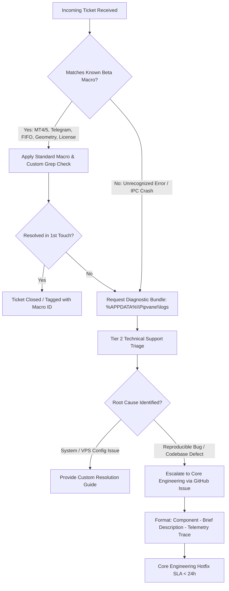

# Pipvane v3: Production Customer Support Macros
## High-Impact Response Templates for Beta Operations (Sprint 23)

* **Document Version:** 3.0.0-PROD
* **Target Audience:** Customer Support Engineers, Technical Account Managers, QA Leads, Beta Operations
* **Compatible Helpdesks:** Zendesk, HelpScout, Freshdesk, Intercom
* **Status:** PRODUCTION READY / SPRINT 23 SIGNOFF
* **Maintainer:** Pipvane v3 Product Management & Support Operations

---

## 1. Operational Framework & Support Standards

### Trader Aesthetic & Communication Philosophy
In financial technology and high-frequency automated execution, traders operate in high-stress, capital-at-risk environments. Support interactions must adhere strictly to the **Trader Aesthetic**:
1. **Capital Preservation First:** Validate immediately that account balance and equity are secure. Relieve the panic of an unexpected execution halt before diving into technicalities.
2. **Technical Precision Without Fluff:** Zero patronizing pleasantries, empty filler phrases ("We hope you're having a wonderful day!"), or corporate deflection. State what occurred, why the safety guard tripped, and how to resolve it.
3. **Deterministic, Step-by-Step Guidance:** Every instruction must be explicit, numbered, and include exact UI buttons, keyboard shortcuts, Windows paths, or PowerShell commands.
4. **Authoritative Engineering Backing:** Explain the underlying architectural reason (e.g., named pipe handle collisions, NFA regulatory constraints, MTProto anti-spam heuristics) so the user gains confidence in Pipvane's safeguards.

### Standard Macro Template Variables
The response bodies use standardized helpdesk variables compatible with Zendesk and HelpScout:
* `{{customer.first_name}}`: Customer's registered given name (falls back to "Trader" if undefined).
* `{{agent.first_name}}`: Support representative name.
* `{{ticket.id}}`: Helpdesk reference ID.

### Support Log Triage Quick Reference
All Pipvane engine runtime logs reside in the per-user `%APPDATA%` directory. When analyzing user reports, support agents can run the following PowerShell diagnostics locally or instruct the user to execute them:

```powershell
# Open the Pipvane log directory
Invoke-Item "$env:APPDATA\Pipvane\logs"

# Search for critical errors and safety tripwires
Select-String -Path "$env:APPDATA\Pipvane\logs\engine.log" -Pattern "ERROR|CRITICAL|SKIP_|EXCEPTION" | Select-Object -Last 50

# Inspect terminal discovery status
Select-String -Path "$env:APPDATA\Pipvane\logs\engine.log" -Pattern "terminal_discovery|IPCDispatcher" | Select-Object -Last 30

# Inspect licensing status and offline token validation
Select-String -Path "$env:APPDATA\Pipvane\logs\engine.log" -Pattern "license_manager|LICENSE_" | Select-Object -Last 30
```

---

## 2. Macro 1: MT4/MT5 Not Detected (Terminal Pathing & IPC DLL Setup Issue)

### Macro Metadata
* **Macro ID:** `MACRO-TRM-01`
* **Title:** `[Terminal] MT4/MT5 Not Detected or IPC Bridge Offline`
* **Category:** `Terminal Integration / IPC Bridge`
* **Triggers / Keywords:** `terminal not detected`, `MT4 disconnected`, `MT5 not found`, `IPC error`, `bridge offline`, `no terminals detected`, `waiting for terminal`, `pipe connection failed`, `PipvaneBridge.dll`, `ipc_bridge_x86.dll`, `DLL loading not allowed`
* **Tags:** `terminal-detection`, `ipc-bridge`, `mt4`, `mt5`, `dll-setup`, `terminal-path`, `sprint-23`

---

### Internal Support Notes (Agent Eyes Only)
* **What Happened Behind the Scenes:**
  Pipvane’s `TerminalDiscovery` subsystem (`engine/terminal_discovery.py`) scans five discrete vectors: (1) Running processes (`terminal.exe` / `terminal64.exe`), (2) Registry uninstall keys (`HKLM`, `HKCU`, and `WOW6432Node`), (3) Roaming MetaQuotes origins (`%APPDATA%\MetaQuotes\Terminal\<hash>\origin.txt`), (4) Standard filesystem paths (`Program Files`, `Program Files (x86)`, `%LOCALAPPDATA%\Programs`), and (5) Custom portable directories.
  Once discovered, the engine provisions a dedicated full-duplex Named Pipe (`\\.\pipe\pipvane_mt_<id>`) and a lock-free SPSC Shared Memory ring buffer (`Local\pipvane_shm_<id>`). If the UI reports "Terminal Disconnected" or "Not Detected", the terminal failed to register its handshake (`MSG_INIT_HELLO`, opcode `0x0001`) via the C++ IPC bridge.
* **Root Causes:**
  1. **Terminal Not Running in Active GUI Session:** Terminal is closed, hung, or running in an isolated Windows session (e.g. Session 0 headless service or alternate Windows user account).
  2. **DLL Imports Disabled in MetaTrader:** The global setting "Allow DLL imports" is disabled in MetaTrader (`Ctrl+O` -> Expert Advisors), blocking `PipvaneBridge.dll` or `ipc_bridge_x86.dll` from loading.
  3. **Bridge DLL Missing or Bitness Mismatch:** The native bridge DLL is not present in `<DataFolder>\MQL4\Libraries\` or `<DataFolder>\MQL5\Libraries\`, or a 32-bit DLL was placed in 64-bit MT5 (or vice versa).
  4. **Expert Advisor Not Attached to Active Chart:** The EA (`Pipvane_MT4.ex4` or `Pipvane_MT5.ex5`) is not attached to an open chart, or "Allow Algorithmic Trading" is toggled off in the main MetaTrader toolbar.
  5. **Non-Standard / Portable Directory:** The terminal was installed on an external or non-standard partition (e.g. `D:\Forex\MT4_Portable\`) without being declared in Pipvane UI Settings.
* **How to Grep Diagnostic Logs:**
  ```powershell
  # Grep for terminal discovery and pipe attachment failures
  Select-String -Path "$env:APPDATA\Pipvane\logs\engine.log" -Pattern "terminal_discovery|IPCDispatcher|connect_terminal|NamedPipeServer" | Select-Object -Last 30
  ```
  Check the MetaTrader Experts log (`<DataFolder>\MQL4\Logs\<date>.log` or `MQL5\Logs\<date>.log`):
  * Look for: `Cannot load 'PipvaneBridge.dll' [126]` (Missing C++ runtime / DLL path).
  * Look for: `DLL loading is not allowed` (MetaTrader security toggle disabled).

---

### Customer-Facing Response Body
```markdown
Hi {{customer.first_name}},

First and most importantly: your capital and open positions are secure. When Pipvane cannot verify an active link to your MetaTrader terminal, execution is automatically locked. No trade signals will be dispatched into an unverified or disconnected session.

Pipvane communicates with MetaTrader 4 and 5 via an ultra-low-latency local Inter-Process Communication (IPC) bridge running through Windows Shared Memory and Named Pipes. For this link to establish, MetaTrader must be running in your active desktop session, the Pipvane Expert Advisor must be running on a chart, and the native bridge DLL must have permission to execute.

Please follow these exact steps to restore the terminal connection:

1. **Verify "Allow DLL Imports" in MetaTrader Settings:**
   * Open your MetaTrader terminal.
   * Press `Ctrl + O` (or navigate to **Tools** > **Options**).
   * Click the **Expert Advisors** tab.
   * Ensure **"Allow Algorithmic Trading"** (or "Allow automated trading") is **checked**.
   * Ensure **"Allow DLL imports"** is **checked**.
   * Ensure **"Confirm DLL function calls"** is **unchecked** (to prevent interactive confirmation prompts from blocking automated ticks).
   * Click **OK**.

2. **Verify the Pipvane Bridge DLL Location:**
   * In MetaTrader, click **File** > **Open Data Folder**.
   * Navigate to the `MQL4` (for MT4) or `MQL5` (for MT5) folder, then open the `Libraries` folder:
     * For **MetaTrader 4 (32-bit):** Verify that `ipc_bridge_x86.dll` is present in `MQL4\Libraries\`.
     * For **MetaTrader 5 (64-bit):** Verify that `PipvaneBridge.dll` is present in `MQL5\Libraries\`.
   * *If the DLL is missing, you can reinstall it automatically by opening Pipvane Settings > Terminals > click "Reinstall Bridge Files".*

3. **Verify the Expert Advisor on an Active Chart:**
   * In MetaTrader's Navigator window (`Ctrl + N`), expand **Expert Advisors**.
   * Locate `Pipvane_MT4` or `Pipvane_MT5` and drag it onto any single open chart (e.g., EURUSD M1).
   * In the EA properties window, click the **Common** tab:
     * Ensure **"Allow live trading"** / **"Allow algorithmic trading"** is checked.
     * Ensure **"Allow DLL imports"** is checked.
   * Click **OK**. Verify that a smiling face (MT4) or blue/green graduation cap icon (MT5) appears in the top-right corner of the chart.

4. **For Custom or Portable Mode Installations:**
   * If your terminal is installed in a custom location (e.g., a secondary drive or portable folder):
   * In the Pipvane Desktop application, open **Settings** > **Terminals**.
   * Click **Add Custom Terminal Path** and select your terminal directory (the folder containing `terminal.exe` or `terminal64.exe`).
   * Click **Scan Now**.

5. **Restart Sequence:**
   * Close MetaTrader completely.
   * Restart MetaTrader from the desktop shortcut (ensure it runs in the same Windows user session as Pipvane).
   * Pipvane will auto-detect the terminal within 5 seconds and display a green "CONNECTED" badge on your dashboard.

If the status does not turn green after completing these steps, please check the **Experts** tab at the bottom of your MetaTrader terminal, right-click inside it, select **Open Folder**, and attach today's log file to your reply. We will pinpoint the exact initialization code for you immediately.

Best regards,  
{{agent.first_name}}  
Pipvane Support Engineering
```

---

### Quick Diagnostic Checklist for Support Engineers
- [ ] Is `terminal.exe` or `terminal64.exe` visible in Windows Task Manager under the active user's session?
- [ ] Is "Allow DLL imports" enabled globally in MetaTrader (`Ctrl+O` -> Expert Advisors)?
- [ ] Is the correct architecture DLL installed (`ipc_bridge_x86.dll` for 32-bit MT4, `PipvaneBridge.dll` for 64-bit MT5)?
- [ ] Is the EA attached to an open chart with "Allow live trading" checked?
- [ ] Does `%APPDATA%\Pipvane\logs\engine.log` show `Registered terminal: mt4_1` or `mt5_1`?
- [ ] Are any antivirus or endpoint protection tools blocking named pipes (`\\.\pipe\pipvane_*`)?

---

## 3. Macro 2: Telegram Ban Warning (Account Safety & Strict Safety Mode Enforcement)

### Macro Metadata
* **Macro ID:** `MACRO-TEL-02`
* **Title:** `[Telegram] Account Safety, Ban Prevention & Strict Read-Only Mode`
* **Category:** `Telegram Integration / Ingestion Safety`
* **Triggers / Keywords:** `telegram ban`, `account safety`, `ban warning`, `tdlib`, `safety mode`, `will my telegram get banned`, `spam flag`, `peer_flood`, `phone banned`, `account restricted`, `channel scraping`
* **Tags:** `telegram`, `tdlib`, `safety-mode`, `account-protection`, `anti-ban`, `mtproto`, `sprint-23`

---

### Internal Support Notes (Agent Eyes Only)
* **What Happened Behind the Scenes:**
  Traders frequently experience account suspensions when using amateur signal scrapers or unofficial MTProto scripts (such as Pyrogram/Telethon bots) that make burst outbound requests, spam chat channels, join 50+ channels in minutes, or cycle through randomized IP/Device profiles.
  Pipvane completely eliminates account risk through its **Strict Safety Mode Guard** (`engine/safety_mode.py`):
  1. **Strict Read-Only Filter:** A hardcoded interceptor blocks and raises `SafetyModeViolationError` if any mutating or outbound TDLib method is invoked (`sendMessage`, `joinChat`, `addReaction`, `editMessage`, `forwardMessages`, etc.). Pipvane cannot post, cannot react, cannot join chats, and cannot alter account state.
  2. **Official Native TDLib API:** Pipvane links directly to official Telegram binary libraries (`tdjson.dll`), strictly honoring Telegram's MTProto transport specifications.
  3. **Persisted Device Profiles (`engine/device_profile.py`):** On initial installation, realistic desktop hardware parameters (device model, OS build, system language) are generated and cryptographically locked into Windows DPAPI SecureVault (`engine/vault.py`). They are reused permanently across sessions. This prevents Telegram's automated anomaly engines from triggering "Geographic Hopping" or "Device Spoofing" flags.
* **Root Causes:**
  1. **User Anxiety / Past Trauma:** User previously had an account banned by using low-quality, outbound-spamming signal copier tools.
  2. **External Rate Limits (`FLOOD_WAIT`):** User manually joined dozens of channels in a short window on an unverified or brand-new phone number using the official Telegram app, triggering a temporary cooldown.
  3. **Third-Party Bots:** User is simultaneously running custom automated Python scripts or forwarding bots on the same phone number.
* **How to Grep Diagnostic Logs:**
  ```powershell
  # Verify Strict Safety Mode enforcement and device profile stability
  Select-String -Path "$env:APPDATA\Pipvane\logs\engine.log" -Pattern "safety_mode|Loaded persisted device profile|FLOOD_WAIT|authorizationState" | Select-Object -Last 30
  ```

---

### Customer-Facing Response Body
```markdown
Hi {{customer.first_name}},

We understand completely why you are asking this. Your Telegram account is vital operational infrastructure, and concerns about spam flags or account bans are entirely justified—especially given how many poorly coded, aggressive scraping bots exist in the trading space.

Capital and operational preservation is our core design principle. Pipvane was engineered from day one to treat account safety with the same zero-tolerance rigor as risk management.

Here is exactly how Pipvane protects your Telegram account from detection and bans:

1. **Strict Read-Only Architecture (Hardware-Enforced Safety Mode):**
   * Unlike generic tools that post confirmations, forward messages, or auto-join channels, Pipvane operates under a strict, code-level read-only filter.
   * Pipvane’s ingestion pipeline physically blocks every outbound write API call. It cannot send messages, add emoji reactions, edit messages, forward content, or join/leave channels. To Telegram’s servers, your session produces zero outbound traffic or spam footprint.

2. **Official Telegram TDLib Engine (Zero Reverse-Engineering):**
   * Pipvane does not use unofficial web scrapers or illicit browser automation. It interfaces directly with Telegram’s official TDLib (Telegram Database Library) JSON interface (`tdjson.dll`), the exact same framework utilized by Telegram’s official desktop applications.

3. **Cryptographically Persisted Device Profiles:**
   * Telegram flags accounts that exhibit anomalous hardware signatures (e.g., switching between mobile, server, and browser fingerprints rapidly).
   * During installation, Pipvane generates a realistic, legitimate desktop workstation profile (Windows OS build, system language, and hardware profile) and encrypts it inside your Windows DPAPI SecureVault. This profile never changes between restarts, appearing to Telegram as your stable, dedicated trading PC.

**Best Practices for 100% Operational Peace of Mind:**
* **Channel Management:** Always search for and join your signal channels directly from your official Telegram desktop or mobile app—never through third-party automated tools.
* **Account Maturity:** If using a dedicated trading number, ensure the account has been active for at least 48 hours and has standard Two-Step Verification (2FA) enabled in Telegram Settings > Privacy and Security.
* **Session Verification:** In Telegram (Settings > Devices), you will see your Pipvane session identified cleanly as a standard Windows Desktop workstation. Leave this session authorized.

You can verify your current security status anytime inside the Pipvane Desktop application by checking the **Telegram Gateway** widget on your dashboard—it will display **"Safety Mode: ACTIVE (Read-Only)"**.

Your account is in safe hands. Please let us know if you have any questions regarding your channel configuration!

Best regards,  
{{agent.first_name}}  
Pipvane Support Engineering
```

---

### Quick Diagnostic Checklist for Support Engineers
- [ ] Is `engine/safety_mode.py` active with zero forbidden methods invoked?
- [ ] Does `%APPDATA%\Pipvane\logs\engine.log` confirm `Loaded persisted device profile` without profile regeneration?
- [ ] Is the user attempting to run external scrapers or forwarding bots on the same phone number?
- [ ] Is Two-Step Verification (2FA) configured on the customer's Telegram account?
- [ ] Did the user trigger an external `FLOOD_WAIT` by bulk-joining channels in the official app?

---

## 4. Macro 3: Trade Skipped: FIFO Rule Blocked Hedge (US NFA Rule 2-43b Compliance)

### Macro Metadata
* **Macro ID:** `MACRO-RSK-03`
* **Title:** `[Execution] Trade Skipped: FIFO Compliance Guard (NFA Rule 2-43b)`
* **Category:** `Trade Execution / Regulatory Compliance`
* **Triggers / Keywords:** `SKIP_FIFO_HEDGE`, `trade skipped FIFO`, `FIFO rule blocked hedge`, `NFA 2-43b`, `cannot hedge`, `opposing trade blocked`, `hedging not allowed`, `FIFO error`, `ERR_TRADE_PROHIBITED_BY_FIFO`, `TRADE_RETCODE_FIFO_CLOSE`
* **Tags:** `fifo`, `skip-fifo-hedge`, `nfa-compliance`, `us-brokers`, `hedging`, `risk-engine`, `sprint-23`

---

### Internal Support Notes (Agent Eyes Only)
* **What Happened Behind the Scenes:**
  The US National Futures Association (NFA) Compliance Rule 2-43(b) strictly prohibits retail forex hedging (holding simultaneous long and short positions on the same pair in the same account) and enforces the First-In, First-Out (FIFO) inventory liquidation rule. Under FIFO, if multiple positions exist for the same currency pair, the oldest position must be closed first.
  In Pipvane, when an account is marked FIFO compliant (either manually via `AccountProfile.fifo_compliant = True` or automatically detected during the `MSG_CAPABILITIES_RESP` handshake with the broker terminal), the `ExecutionOrchestrator` (`engine/execution_orchestrator.py`) enforces two pre-trade safety tripwires:
  1. **Hedge Interception (`SKIP_FIFO_HEDGE`):** If a BUY signal is parsed for EURUSD while an active SELL position already exists on that terminal (or vice versa), Pipvane halts the order before dispatch. If Pipvane allowed the order through, the US broker would reject it with an error (MT4 Error 149 / MT5 Retcode 10034) or cause an unhedged forced liquidation.
  2. **Sequential FIFO Liquidation:** When closing positions, `execute_fifo_closure()` queries the local SQLite ledger and closes lots strictly starting from the oldest active ticket (`ORDER BY created_at ASC, ticket ASC`).
* **Root Causes:**
  1. **User Connected to a US-Regulated Broker (Forex.com, OANDA US, IG US):** The signal provider published an opposing trade (e.g. SELL while the user is still in a BUY from an earlier signal).
  2. **Accidentally Toggled FIFO Mode on an Offshore / Hedging Account:** The user enabled "FIFO Enforced" in Pipvane Account Profile settings even though their broker supports full hedging.
  3. **Signal Provider Scalping Both Sides:** Provider sent a hedge signal to lock in drawdown, which is legally prohibited on US retail accounts.
* **How to Grep Diagnostic Logs:**
  ```powershell
  # Grep for FIFO hedge blocks and opposing ticket numbers
  Select-String -Path "$env:APPDATA\Pipvane\logs\engine.log" -Pattern "SKIP_FIFO_HEDGE|fifo_compliance_guard|ERR_TRADE_PROHIBITED_BY_FIFO|TRADE_RETCODE_FIFO_CLOSE" | Select-Object -Last 30
  ```

---

### Customer-Facing Response Body
```markdown
Hi {{customer.first_name}},

First and foremost: your trading capital and margin were fully protected. Pipvane’s pre-execution risk engine intercepted and blocked this order to prevent an immediate broker rejection, transaction penalty, or unexpected position liquidation on your account.

You received a **`SKIP_FIFO_HEDGE`** notification because your trading account is subject to **US NFA Rule 2-43(b)** (First-In, First-Out and No-Hedging compliance), or has FIFO mode enabled in your account profile.

Here is the exact technical explanation of what happened:

1. **Why the Order Was Intercepted:**
   * Your signal provider dispatched a new trade signal in one direction (for example, a **SELL** on EURUSD).
   * However, you already had an active, open position in the opposite direction (for example, a **BUY** on EURUSD) open on your terminal.
   * Under US regulatory rules, holding simultaneous opposing positions (hedging) on the same instrument is strictly illegal. 
   * Had Pipvane dispatched this trade, your broker would have returned a hard execution fault (`TRADE_RETCODE_FIFO_CLOSE` or `ERR_TRADE_PROHIBITED_BY_FIFO`). Pipvane’s local compliance guard caught this in microseconds and safely discarded the violating order.

2. **How Pipvane Handles FIFO Closures:**
   * When your provider issues a close or partial take-profit signal, Pipvane automatically routes the closure to your **oldest open ticket first**, ensuring 100% compliance with NFA liquidation sequencing.

**Recommended Actions & Account Configuration:**

* **If You Are Trading With a US Broker (e.g., OANDA US, Forex.com US, IG US):**
  * No action is required. The system performed exactly as designed to protect your account compliance.
  * In Pipvane **Settings** > **Trading Profiles**, you can configure how you wish opposing signals to be handled:
    * **Skip Opposing Order (Default):** Retains your existing position and ignores contradictory hedge signals.
    * **Netting Mode (Close Opposing First):** Liquidates the existing position before executing the new signal direction.

* **If You Are Trading With a Non-US / Offshore Broker (Full Hedging Permitted):**
  * If your broker allows simultaneous BUY and SELL positions (e.g. ASIC, FCA, or offshore regulated accounts):
  * Open Pipvane Desktop > **Settings** > **Account Profiles**.
  * Select your terminal account profile.
  * Toggle **"Enforce NFA FIFO Rule 2-43(b)"** to **OFF**.
  * Click **Save Changes**. Future signals will execute simultaneous hedged positions without restriction.

You can review all open tickets that caused the hedge conflict directly in Pipvane’s **Signal Journal** under the "Skipped Orders" tab.

Please let us know if you need assistance verifying your broker's account specifications!

Best regards,  
{{agent.first_name}}  
Pipvane Support Engineering
```

---

### Quick Diagnostic Checklist for Support Engineers
- [ ] Is the user's broker subject to US CFTC/NFA jurisdiction (e.g. OANDA US, Forex.com)?
- [ ] Does `%APPDATA%\Pipvane\logs\engine.log` log `SKIP_FIFO_HEDGE ENFORCED` with the active opposing ticket IDs?
- [ ] Did the user inadvertently enable `fifo_compliant: true` on an offshore hedging account?
- [ ] Does the signal channel frequently alternate between BUY and SELL on the same currency pair without closing previous entries?

---

## 5. Macro 4: Trade Skipped: Geometry Error (SL on Wrong Side of Entry, SKIP_GEOMETRY)

### Macro Metadata
* **Macro ID:** `MACRO-SIG-04`
* **Title:** `[Signal Parsing] Trade Skipped: Market Geometry Violation (SKIP_GEOMETRY)`
* **Category:** `Signal Ingestion / Market Geometry`
* **Triggers / Keywords:** `SKIP_GEOMETRY`, `geometry error`, `SL on wrong side`, `stop loss above entry`, `trade skipped geometry`, `invalid SL`, `take profit below entry`, `geometry validation failed`, `invalid stop level`, `ERR_INVALID_STOPS`
* **Tags:** `skip-geometry`, `signal-parser`, `invalid-stops`, `stop-loss`, `risk-engine`, `signal-syntax`, `sprint-23`

---

### Internal Support Notes (Agent Eyes Only)
* **What Happened Behind the Scenes:**
  Pipvane’s `SignalParser` executes deterministic mathematical market geometry validation via `validate_geometry(signal)` (`engine/signal_parser.py`):
  * **BUY Geometry Rules:**
    1. Stop Loss must be strictly below Entry Price (`SL < Entry`).
    2. Take Profits must be strictly above Entry Price (`TP > Entry`).
    3. Take Profit ladder must be strictly ascending (`TP1 < TP2 < TP3`).
  * **SELL Geometry Rules:**
    1. Stop Loss must be strictly above Entry Price (`SL > Entry`).
    2. Take Profits must be strictly below Entry Price (`TP < Entry`).
    3. Take Profit ladder must be strictly descending (`TP1 > TP2 > TP3`).
  Signal providers frequently make manual typographical errors (e.g. typing `BUY GOLD @ 2650 | SL: 2680 | TP: 2610` or swapping BUY for SELL). If dispatched to MetaTrader, this order would result in MT4/MT5 Error 130 (`ERR_INVALID_STOPS`) or Error 10016 (`TRADE_RETCODE_INVALID_STOPS`), or worse: execute at market and suffer an immediate stop-out at a loss.
  Pipvane’s pre-execution geometry filter intercepts this error locally, records `SKIP_GEOMETRY` with the exact mathematical violation reason, and halts execution on that malformed signal.
* **Root Causes:**
  1. **Signal Provider Typo:** The channel admin reversed Stop Loss and Take Profit numbers, or wrote BUY instead of SELL.
  2. **Format Template Misconfiguration:** A custom user regex pattern mapped `<tp1>` to the Stop Loss field or vice versa.
  3. **Multi-Target Inversion:** Provider listed Take Profits in reverse order without standard descending formatting on a short position.
* **How to Grep Diagnostic Logs:**
  ```powershell
  # Grep for market geometry rejections and raw parsed values
  Select-String -Path "$env:APPDATA\Pipvane\logs\engine.log" -Pattern "SKIP_GEOMETRY|GeometryValidationError|failed geometry" | Select-Object -Last 30
  ```

---

### Customer-Facing Response Body
```markdown
Hi {{customer.first_name}},

Your capital and balance were preserved from an immediate, guaranteed loss. Pipvane’s pre-execution geometry filter intercepted and blocked this trade because the signal published in your Telegram channel contained inverted price levels that violate core market mechanics.

You received a **`SKIP_GEOMETRY`** notification because the relationship between the entry price, stop loss, and take profit in the signal was physically contradictory.

Here is why this safety guard tripped:

1. **Market Order Geometry Rules:**
   * **For a BUY Order:** The Stop Loss **must be lower than** the Entry Price, and Take Profits **must be higher than** the Entry Price.
   * **For a SELL Order:** The Stop Loss **must be higher than** the Entry Price, and Take Profits **must be lower than** the Entry Price.

2. **What Happened on This Trade:**
   * Your signal provider published a signal where the Stop Loss was placed on the wrong side of the market (for example: calling a *BUY* with a Stop Loss set *above* the current price, or calling a *SELL* with a Stop Loss set *below* the entry price).
   * **The Risk to Your Account:** Had Pipvane transmitted this order to your broker, one of two things would have occurred:
     * Your broker’s trade server would have rejected the order immediately with `Error 130: Invalid Stops`.
     * Or, on ECN market execution accounts, the order would have filled at market and **instantly closed at a total loss** the exact microsecond the Stop Loss was applied.
   * Pipvane’s pre-execution engine caught this error in under 1 millisecond and safely discarded the malformed order.

**How to Investigate and Configure Protection:**

1. **Inspect the Raw Channel Message:**
   * Open your Telegram channel and look at the original post for that trade. Compare the numbers: did the provider accidentally swap their SL and TP, or mistake a BUY for a SELL?

2. **Check the Pipvane Signal Journal:**
   * Open the Pipvane Desktop app and navigate to **Signal Journal** > **Skipped Trades**.
   * Click on the skipped signal to view the exact extraction details:
     * Example: `SKIP_GEOMETRY: BUY Stop Loss (2680.0) must be strictly below Entry price (2650.0)`.

3. **Configure Fallback Protection (Risk Settings):**
   * If your channel provider frequently makes typographical errors, you can define how Pipvane handles them:
   * Go to **Settings** > **Risk Engine** > **Geometry Violations**:
     * **Strict Reject (Recommended):** Rejects all malformed signals completely (safest).
     * **Auto-Apply Default Risk SL:** Discards the provider's erroneous SL and calculates an emergency Stop Loss based on your preset account risk (e.g. 30 pips).

If you believe the original signal text was mathematically valid and Pipvane’s parser misread a unique abbreviation, please reply with a screenshot or copy of the raw message. Our engineers will inspect the syntax and update your channel format pack immediately.

Best regards,  
{{agent.first_name}}  
Pipvane Support Engineering
```

---

### Quick Diagnostic Checklist for Support Engineers
- [ ] Does `%APPDATA%\Pipvane\logs\engine.log` show `SKIP_GEOMETRY` with the explicit price values?
- [ ] Was the order a BUY with `SL >= Entry` or a SELL with `SL <= Entry`?
- [ ] Was the Take Profit ladder inverted (e.g. `TP2 < TP1` on a BUY)?
- [ ] Was the user’s custom channel parsing template misconfigured, swapping `<sl>` and `<tp>` tags?
- [ ] Did the signal provider edit the post after the initial error was flagged?

---

## 6. Macro 5: License Expired (30-Day Offline Grace Limit & 7-Day Silent Refresh Blocked)

### Macro Metadata
* **Macro ID:** `MACRO-LIC-05`
* **Title:** `[Licensing] License Expired / 30-Day Offline Cryptographic Limit Reached`
* **Category:** `Account & Licensing / Cryptographic Authentication`
* **Triggers / Keywords:** `license expired`, `offline grace period`, `silent refresh failed`, `license lock`, `30-day limit reached`, `JWT expired`, `renew license`, `cannot execute trades license`, `LICENSE_EXPIRED`, `ui_status_banner Expired`
* **Tags:** `license-expired`, `offline-grace`, `jwt-validation`, `silent-refresh`, `dpapi-vault`, `account-lock`, `sprint-23`

---

### Internal Support Notes (Agent Eyes Only)
* **What Happened Behind the Scenes:**
  Pipvane v3 employs an offline-first cryptographic licensing architecture (PRD Directives FR-8.1 & FR-8.4, implemented in `engine/license_manager.py`). 
  1. **30-Day Cryptographic Hard Expiry:** Every license token is an offline-verifiable RSA/Ed25519 digitally signed JWT stored in the Windows DPAPI SecureVault (`engine/vault.py`). It has a strict 30-day expiration timestamp (`exp`).
  2. **7-Day Silent Refresh Daemon:** Pipvane spins up a background thread that attempts a silent token renewal every 7 days (`SEVEN_DAYS_SECONDS = 604,800s`) against `https://control.pipvane.com/api/v1/license/refresh`.
  3. **Fail-Safe Offline Operation:** If a user’s VPS loses internet connectivity to our cloud servers, trading continues seamlessly for up to 30 days without interruption.
  4. **The Lock Condition:** If 30 consecutive days elapse without a single successful refresh (e.g., VPS firewall blocked HTTPS port 443, local DNS failed, or system clock drifted $>300\text{ seconds}$), the token reaches its mathematical cryptographic expiration (`LicenseExpiredError`). The engine enters a safe locked state (`is_locked = True`) to prevent unauthorized execution.
* **Root Causes:**
  1. **VPS Outbound Network / Firewall Restriction:** VPS firewall or corporate security group blocks outbound HTTPS requests to `control.pipvane.com:443`.
  2. **Severe Local Clock Drift (> 300 Seconds):** The VPS Windows Time service (`w32time`) drifted, causing the local validation timestamp to exceed the token’s cryptographic `exp`.
  3. **Air-Gapped / Isolated VPS:** User deployed on an isolated trading server without external internet access for $>30$ days.
  4. **Active Subscription desync:** Stripe billing renewed, but the local client was shut down or unable to reach the license refresh endpoint.
* **How to Grep Diagnostic Logs:**
  ```powershell
  # Grep for licensing verification errors, expired JWT tokens, and silent refresh failures
  Select-String -Path "$env:APPDATA\Pipvane\logs\engine.log" -Pattern "LICENSE_EXPIRED|silent_refresh|LicenseValidationStatus|refresh_failed" | Select-Object -Last 30
  ```

---

### Customer-Facing Response Body
```markdown
Hi {{customer.first_name}},

First and most importantly: all existing open positions in your MetaTrader terminal remain completely untouched and secure. When your license token reaches its offline renewal limit, Pipvane enters a fail-safe lock mode to prevent new unsynchronized orders from executing, while leaving your active broker trades under MetaTrader’s direct management.

You are seeing the **`License Expired`** alert because your local installation reached its **30-day offline cryptographic grace boundary** without completing its background renewal.

Here is how Pipvane’s licensing works and how to resolve this in 60 seconds:

1. **Why This Occurred (Offline-First Architecture):**
   * Pipvane is engineered with zero cloud dependencies during trading: your VPS can run disconnected from our cloud servers for up to **30 consecutive days** without interrupting execution.
   * Under the hood, Pipvane automatically attempts a silent background refresh every 7 days via secure HTTPS.
   * If your VPS was offline, had its system clock drifted, or had outbound network traffic to our licensing endpoints blocked for over 30 consecutive days, the local cryptographic security token reached its expiration limit.

2. **Resolution Steps (Restoring Full Execution):**

   * **Step 1: Verify VPS Outbound HTTPS Connectivity**
     * Open PowerShell on your VPS and run this quick connectivity test:
       ```powershell
       Test-NetConnection control.pipvane.com -Port 443
       ```
     * Ensure `TcpTestSucceeded` returns **True**. If it returns False, check your VPS firewall or hosting provider security group to allow outbound traffic on port 443.

   * **Step 2: Resynchronize Your Windows VPS Clock**
     * Cryptographic validation requires your system clock to be accurate within 5 minutes.
     * In an elevated (Administrator) PowerShell prompt, run:
       ```powershell
       w32tm /resync /force
       ```

   * **Step 3: Force Instant One-Click Renewal**
     * Open the Pipvane Desktop application.
     * Navigate to **Settings** > **License & Subscription**.
     * Click the **"Refresh License Now"** button.
     * Your license will immediately validate, renewing your 30-day offline execution window and displaying a green **"Active"** status.

3. **Air-Gapped / Manual Key Activation (Alternative):**
   * If your VPS resides behind a restricted network that cannot communicate with our licensing server:
   * Log into your web dashboard at [https://app.pipvane.com/account/license](https://app.pipvane.com/account/license).
   * Copy your current **30-Day Offline Activation Key**.
   * In Pipvane Desktop, paste the key into the **Manual License Key** field and click **Apply Token**.

Once refreshed, your engine will automatically unlock, resume signal monitoring, and display full account connectivity.

If your subscription is active in the portal but the refresh button returns an error, please reply with your registered account email and we will inspect your license lease immediately!

Best regards,  
{{agent.first_name}}  
Pipvane Support Engineering
```

---

### Quick Diagnostic Checklist for Support Engineers
- [ ] Is the customer's subscription active and in good standing in Stripe / Cloud Portal?
- [ ] Can the customer's VPS resolve and connect to `control.pipvane.com:443`?
- [ ] Is the VPS system clock synchronized via NTP (clock drift $< 5\text{ s}$)?
- [ ] Does `%APPDATA%\Pipvane\logs\engine.log` show `LICENSE_EXPIRED: 30-day offline grace period exceeded`?
- [ ] Has the customer attempted the one-click "Refresh License Now" or manual offline token paste?

---

## 7. Support Escalation Matrix & Telemetry Runbook

To maintain our SLA commitments (First Response $< 15\text{ min}$, Resolution $< 2\text{ hours}$ for Critical Execution blockers), use the following escalation protocol:



### Escalation Tiers & Response Expectations

| Tier | Handled By | Scope & Responsibilities | Target SLA |
|:---|:---|:---|:---:|
| **Tier 1** | Support Operations / TAMs | Macro distribution, user credential issues, basic terminal pathing, MetaTrader DLL settings, general FIFO and geometry explanations. | $< 15\text{ min}$ response |
| **Tier 2** | Technical Support Engineers | VPS RDP keep-alive troubleshooting, named pipe collision debugging, TDLib authorization resets, custom regex format pack construction, DPAPI vault inspection. | $< 1\text{ hour}$ response |
| **Tier 3** | Core Systems Engineering | C++ DLL crashes (`PipvaneBridge.dll`), kernel Shared Memory allocation faults, MTProto encryption failures, SQLite WAL corruption, failover split-brain locks. | $< 4\text{ hour}$ triage / hotfix |

### Required Telemetry for Tier 3 Escalation
When escalating to Core Engineering, the internal ticket must include:
1. **Pipvane Engine Log:** Complete `%APPDATA%\Pipvane\logs\engine.log`.
2. **Watchdog Log:** `%APPDATA%\Pipvane\watchdog.log`.
3. **MetaTrader Experts Log:** `<DataFolder>\MQL4\Logs\<date>.log` or `MQL5\Logs\<date>.log`.
4. **Environment Profile:** Windows OS build, MetaTrader terminal build number, broker name, and account jurisdiction (US FIFO vs Offshore Hedging).
5. **Exact Signal Text:** The raw, unformatted Telegram message text that triggered the incident.
