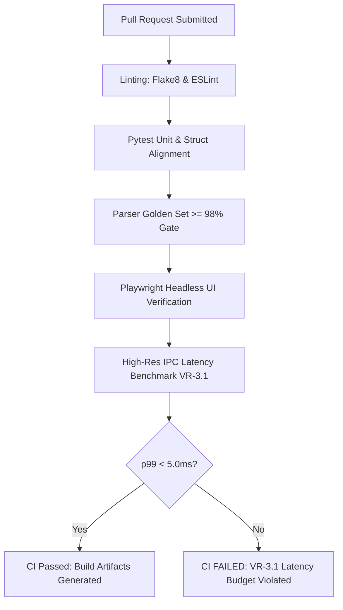

# Pipvane v3: Latency Measurement & Benchmark Strategy (VR-3.1)
## Validating Sub-5ms IPC Dispatch and Real-Time Signal Throughput

* **Document Version:** 3.0.0-QA-SPEC
* **Standard Reference:** VR-3.1 (Sub-5ms Execution Latency) & ADR-001 (Hybrid SPSC Shared Memory / Named Pipe Bridge)
* **Author:** Pipvane QA Automation Engineer
* **Target Audience:** Engine Engineers, Bridge Engineers, CI/CD Maintainers

---

## 1. Executive Summary & Latency Budget Allocation

Pipvane v3 mandates that the entire path from Telegram signal ingestion to broker order dispatch execute in **under 5.0 milliseconds ($< 5,000\text{ }\mu\text{s}$)** under peak conditions. In high-frequency news bursts (e.g., US Non-Farm Payrolls or FOMC interest rate announcements), signal bursts can reach **50 signals/minute**.

To mathematically guarantee compliance with VR-3.1, the 5.0ms global budget is partitioned into deterministic micro-budgets:

| Pipeline Stage | Subsystem | Target Latency | Strict Ceiling | Implementation Mechanism |
| :--- | :--- | :--- | :--- | :--- |
| **Stage 1: Ingestion & Normalization** | Engine Listener | $0.80\text{ ms}$ | $1.50\text{ ms}$ | Async MTProto listener, fast regex, unicode translation table |
| **Stage 2: Risk Guard & Routing** | Risk Controller | $0.20\text{ ms}$ | $0.50\text{ ms}$ | In-memory balance check, equity guard ceiling, FIFO validator |
| **Stage 3: Native IPC Dispatch** | SPSC Ring Buffer | **$0.02\text{ ms}$ ($20\text{ }\mu\text{s}$)** | **$0.05\text{ ms}$ ($50\text{ }\mu\text{s}$)** | Zero-copy Windows Shared Memory (`Local\pipvane_shm_*`) |
| **Stage 4: Terminal Bridge Ingestion** | C++ MetaTrader DLL | $0.15\text{ ms}$ | $0.35\text{ ms}$ | Lock-free atomic acquire, 128-byte cache-aligned slot read |
| **Stage 5: Terminal Win32 Dispatch** | MT4/MT5 Client EA | $0.30\text{ ms}$ | $0.60\text{ ms}$ | Direct native `OrderSend` / `OrderSendAsync` C++ invocation |
| **Stage 6: Broker Transmission** | Network Layer | $1.20\text{ ms}$ | $2.00\text{ ms}$ | Localhost/VPS Cross-Connect to Broker Server |
| **Total End-to-End Pipeline** | **Pipvane v3 System** | **$\mathbf{2.67\text{ ms}}$** | **$\mathbf{5.00\text{ ms}}$** | **VR-3.1 Compliant** |

---

## 2. High-Resolution Monotonic Timing Primitives

Standard wall-clock functions (`time.time()`, `Date.now()`, `GetSystemTime()`, `std::chrono::system_clock`) are **strictly prohibited** in Pipvane performance benchmarks. Wall clocks are vulnerable to NTP time-synchronization slewing, manual clock adjustments, leap seconds, and virtual hypervisor drift.

Only monotonic hardware performance counters are permitted:

### 2.1 C++ / Native DLL Layer
The native bridge utilizes the Windows Win32 High-Resolution Performance Counter API:
```cpp
// Query CPU frequency once during initialization
LARGE_INTEGER g_perf_frequency;
QueryPerformanceFrequency(&g_perf_frequency);

// Timestamp capture with sub-100 nanosecond precision
inline uint64_t GetMonotonicNanoseconds() {
    LARGE_INTEGER counter;
    QueryPerformanceCounter(&counter);
    return static_cast<uint64_t>((counter.QuadPart * 1'000'000'000ULL) / g_perf_frequency.QuadPart);
}
```
For ultra-low-overhead hot paths on x86-64 CPUs, cycle counting via compiler intrinsics (`__rdtsc()`) is used to profile individual memory operations without syscall overhead.

### 2.2 Python Engine Layer
The local agent engine uses `time.perf_counter_ns()` which wraps Windows `QueryPerformanceCounter`:
```python
import time

t0_ns = time.perf_counter_ns()
# ... IPC shared memory ring buffer write ...
t1_ns = time.perf_counter_ns()
elapsed_us = (t1_ns - t0_ns) / 1_000.0
```

### 2.3 Node.js / TypeScript Layer
The dashboard and IPC client wrappers leverage `process.hrtime.bigint()`:
```typescript
const startNs = process.hrtime.bigint();
// ... Named pipe control operation ...
const endNs = process.hrtime.bigint();
const elapsedMs = Number(endNs - startNs) / 1_000_000;
```

---

## 3. Synthetic Burst Generation Architecture (50 Signals/Min)

To validate system behavior under extreme conditions, the benchmark test harness simulates high-density trade bursts.

### 3.1 Traffic Injection Models
1. **Steady-State Cadence:** 1 signal every 1.2 seconds ($50\text{ signals/min}$).
2. **Volatile Wave Burst:** 10 signals dispatched simultaneously within a $15\text{ ms}$ window to simulate news release reactions (e.g. 10 parallel currency pairs or accounts reacting to US CPI).
3. **Multi-Terminal Fanout:** 1 signal fanned out to 7 concurrent terminal ring buffers (`Local\pipvane_shm_0` through `Local\pipvane_shm_6`).

### 3.2 Lock-Free SPSC Memory Buffer Architecture
* **Ring Buffer Capacity:** 1024 slots $\times$ 128 bytes = 128 KB segment (powers of 2 ensure efficient modulo indexing via bitwise AND: `seq & (1024 - 1)`).
* **Cache Line Isolation:** 
  * Producer write head resides on Cache Line 1 (Offset 64).
  * Consumer read tail resides on Cache Line 2 (Offset 128).
  * Eliminates false sharing between the Python Engine process and the MT5 terminal DLL thread.
* **Zero Allocations:** Memory is mapped once at initialization via `CreateFileMappingW`. No dynamic allocations (`malloc`, `new`) occur during signal dispatch.

```
+---------------------------------------------------------------------------------------+
| CACHE LINE 0 (0x00 - 0x3F): Header & Config (Magic: PIPV, Cap: 1024, Slot: 128)      |
+---------------------------------------------------------------------------------------+
| CACHE LINE 1 (0x40 - 0x7F): Producer Write Head (Atomic uint64 write_sequence)       |
+---------------------------------------------------------------------------------------+
| CACHE LINE 2 (0x80 - 0xBF): Consumer Read Tail (Atomic uint64 read_sequence)         |
+---------------------------------------------------------------------------------------+
| CACHE LINE 3 (0xC0 - 0xFF): Diagnostics & Telemetry (Min/Max/Avg Latency)             |
+---------------------------------------------------------------------------------------+
| SLOT 0 [128 Bytes] | SLOT 1 [128 Bytes] | ... | SLOT 1023 [128 Bytes]                 |
+---------------------------------------------------------------------------------------+
```

---

## 4. Statistical Distribution & Hard CI Gate Criteria

Latency cannot be evaluated by averages alone. Single outlier spikes (tail latency) can lead to severe slippage or broker requotes. We enforce strict percentiles:

### CI Verification Thresholds:
1. **Shared Memory IPC Critical Path (Engine -> DLL):**
   * **p50 (Median):** $\le 10.0\text{ }\mu\text{s}$ ($0.010\text{ ms}$)
   * **p95:** $\le 30.0\text{ }\mu\text{s}$ ($0.030\text{ ms}$)
   * **p99:** $\le 50.0\text{ }\mu\text{s}$ ($0.050\text{ ms}$)
   * **Max Ceiling:** $< 500.0\text{ }\mu\text{s}$ ($0.500\text{ ms}$)

2. **Total Local Ingestion-to-IPC Pipeline (Parse + Risk + SHM):**
   * **p50 (Median):** $\le 1.20\text{ ms}$
   * **p95:** $\le 2.50\text{ ms}$
   * **p99:** $\le 4.50\text{ ms}$
   * **Max Ceiling (VR-3.1):** $\mathbf{< 5.00\text{ ms}}$

> [!CAUTION]
> **Zero Tolerance Gate:** If any automated test run reports a **p99 latency $\ge 5.00\text{ ms}$** or a maximum latency $\ge 10.00\text{ ms}$, the GitHub Actions CI pipeline **fails immediately**, blocking deployment or PR merges.

---

## 5. CI Runner Environment Isolation & Hypervisor Jitter Mitigation

Running microsecond-level benchmarks inside cloud-hosted virtual machines (e.g. GitHub Actions `windows-latest` or `ubuntu-latest` runners) introduces hypervisor scheduling jitter (noisy neighbors, CPU oversubscription, interrupt remapping).

To achieve reproducible, deterministic benchmarks in CI, the test harness applies the following engineering mitigations:

### 5.1 CPU Affinity Pinning
The benchmarking thread pins its execution to an isolated core to prevent OS thread migrations between different physical cores and L1/L2 cache evictions:
```cpp
// Windows API
SetThreadAffinityMask(GetCurrentThread(), 0x01); // Pin to Core 0
```
```python
# Python Windows API via psutil or ctypes
import psutil
psutil.Process().cpu_affinity([0])
```

### 5.2 Thread Priority Escalation
The benchmark runner raises its Windows scheduling priority to eliminate preemption from background OS services:
```cpp
SetThreadPriority(GetCurrentThread(), THREAD_PRIORITY_TIME_CRITICAL);
```

### 5.3 Warm-Up Phase & JIT Discard
The first 50 to 500 iterations are executed as untracked warm-up cycles. This primes:
* CPU instruction and data caches (L1/L2).
* Memory page table TLB lookups.
* OS virtual memory page faults (all shared memory pages are touched and committed).
* Python runtime bytecode compilation and function caches.

### 5.4 Pre-Test Jitter Calibration
Before executing the primary latency suite, the runner samples 1,000 back-to-back timer queries to quantify underlying hypervisor jitter:
* If the baseline jitter of `QueryPerformanceCounter` exceeds $1.0\text{ }\mu\text{s}$, the runner logs a diagnostic environmental warning.

---

## 6. Automated Pipeline Integration

The latency benchmark strategy is implemented as a continuous multi-layered pipeline:



1. **Micro-Bench Harness (`qa/benchmark/latency_benchmark.py`):**
   * Automatically executed in CI.
   * Generates machine-readable `latency_benchmark_results.json` containing full percentile breakdown.
2. **JMeter High-Throughput Suite (`qa/pipvane_latency_load_test.jmx`):**
   * Simulates 50 signals/minute sustained load across 10 concurrent threads.
   * Groovy JSR223 pre/post processors enforce nanosecond assertions on HTTP and IPC dispatch endpoints.
3. **Artifact Reporting:**
   * Benchmark and JMeter result tables are published directly into the CI build summary for immediate review by the engineering team.
